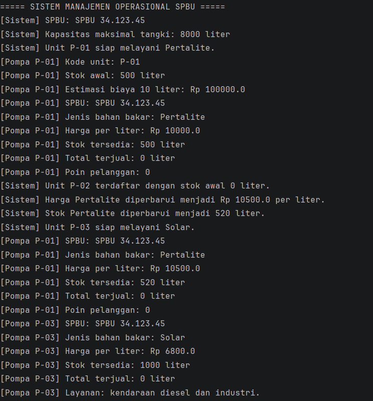
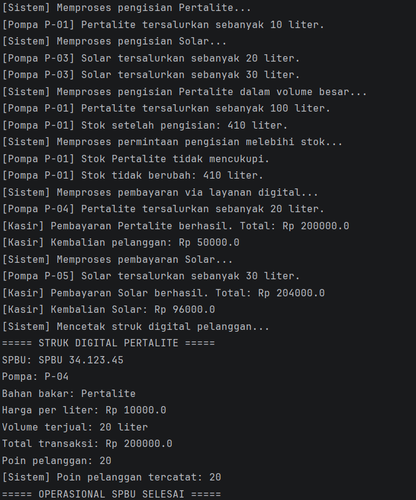

# Responsi Akhir PBO - Sistem SPBU

Repositori ini memuat implementasi *source code* untuk tugas Responsi Akhir Praktikum Pemrograman Berorientasi Objek (PBO). Sistem ini memodelkan logika operasional Stasiun Pengisian Bahan Bakar Umum (SPBU) dengan menerapkan 10 prinsip utama arsitektur OOP secara kohesif.

## Identitas Mahasiswa
* **Nama**: Muhammad Rifqi Khoerulli
* **NIM**: H1D025122
* **Tema Sistem**: SPBU

## Persyaratan Teknis OOP yang Diimplementasikan
Sistem ini telah memenuhi 10 persyaratan teknis responsi:
1. State dan Behavior (Atribut, prosedur, fungsi)
2. Immutability (Konstanta global dan atribut *final*)
3. Enkapsulasi dan Overloading (Akses *private*, *getter/setter*, *overloaded constructor*)
4. Inheritance (*Superclass* abstrak dan *subclass*)
5. Super Chaining (Pemanggilan `super()` dan `super.method()`)
6. Method Overriding (Anotasi `@Override`)
7. Abstract Class (*Method* abstrak pada kelas induk)
8. Logika State Percabangan (Validasi *if/else* yang mengubah state objek)
9. Polimorfisme Interface (Instansiasi objek melalui tipe antarmuka)
10. Multiple Interface (Satu *subclass* mengimplementasi dua antarmuka sekaligus)

## Petunjuk Compile dan Run melalui Terminal

Pastikan Anda berada di *root* direktori proyek tempat folder `src` dan file ini berada. Buka terminal (CMD/PowerShell/Bash) dan jalankan perintah berurutan berikut:

**1. Kompilasi Kode (Compile)**
```bash
javac -d bin src/*.java
```

**2. Menjalankan Program (Run)**
```bash
java -cp bin Main
```

## Screenshot Luaran Program
Berikut adalah bukti eksekusi program yang memvalidasi jalannya kesepuluh persyaratan teknis di atas:



